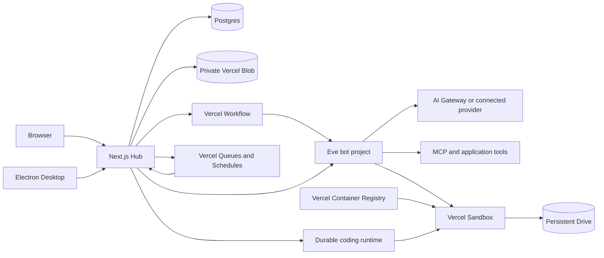

# Busy handbook

**Your own team of AI bots, each with memory, tools and its own computer.**

Busy is a self-hosted application for working with AI agents from a browser or
a native macOS window. You run the Hub in your own Vercel account, connect your
own model accounts and tools, and deploy each bot as a separate agent project.
Bots can work with files, browse the web, use a visible Linux desktop, maintain
memory, run routines, consult other bots and hand off repository work to a
durable coding agent.

This repository contains the **Hub, Desktop client, bot runtime template and
bot computer image**. It is the application source distribution. An
installation uses its operator's own infrastructure, credentials and billing.

## Contents

- [What you can run](#what-you-can-run)
- [Architecture and its rationale](#architecture-and-its-rationale)
- [Vercel components](#vercel-components)
- [Repository map](#repository-map)
- [Requirements and versions](#requirements-and-versions)
- [Install and run locally](#install-and-run-locally)
- [Deploy your own installation](#deploy-your-own-installation)
- [Environment configuration](#environment-configuration)
- [Desktop development and distribution](#desktop-development-and-distribution)
- [How to change the application](#how-to-change-the-application)
- [Tests and fork CI](#tests-and-fork-ci)
- [Security and data ownership](#security-and-data-ownership)
- [Operations and troubleshooting](#operations-and-troubleshooting)
- [Documentation index](#documentation-index)
- [License](#license)
- [Acknowledgements](#acknowledgements)

## What you can run

- **Hub:** the web application, authentication, bot directory, chat, files,
  settings, skills, provider connections and backend APIs.
- **Desktop:** an Electron client that loads your Hub and adds macOS window
  integration, the ChatGPT loopback authorization flow and application updates.
- **Bots:** individual Eve agents deployed by the Hub, with their own runtime
  configuration, sessions and sandbox computers.
- **Bot computer:** a Linux image with Chrome, LibreOffice, PDF and spreadsheet
  tooling, a visible desktop and guarded browser/desktop wrappers.
- **Durable work:** routines, human approvals, delegated tasks and coding work
  whose lifecycle is represented independently of an open browser tab.

The current product uses one shared application workspace. Password login is a
single configured account; optional Vercel login can admit an explicit set of
users to that same workspace. The code is not a ready-made multi-tenant SaaS
with independent customer workspaces, billing and tenant isolation.

The web UI works in a browser, including mobile layouts. The included native
packaging target is **macOS on Apple Silicon**. There is no separate iOS or
Android application in this repository.

A local Hub can be developed with only a local database. Running bots, their
computers and cloud workflows requires the Vercel resources described below.

## Architecture and its rationale



The diagram shows responsibilities, not a claim that all work travels through
a single queue. Ordinary chat, scheduled work and remote coding have different
paths. The detailed flow and implementation references are in
[docs/architecture.md](architecture.md).

### A Hub that owns application state

Next.js keeps the UI, session checks, authenticated APIs and server-side data
access together. The Hub projects agent events into a stable chat experience
and records lifecycle state in Postgres. The browser can reconnect and read
that state instead of being the owner of a long-running task.

This keeps application behavior in one place for the browser and Desktop.
It also means the Hub is an important operational dependency: a deployment,
database outage or incorrect configuration affects both clients.

### A separate project for each bot

The Hub bundles `templates/bot` and creates or updates a Vercel project for a
bot. Eve supplies the agent runtime, durable sessions, tools, memory integration
and human interaction protocol. Bot-specific roles and model choices are
configuration; they do not require copying the whole Hub for each bot.

Separate projects give bots their own deployment and runtime identity, so a bot
can be redeployed independently. The trade-off is provisioning more projects,
managing their lifecycle and respecting the operator's team limits. The bots
still share application-level capabilities through the Hub; separate projects
do not imply separate user accounts or separate customer tenants.

### Durable orchestration and disposable compute

The Hub uses the **Vercel Workflow SDK** for orchestration such as deployments,
turn synchronization and follow-up work. Ordinary bots use **Eve**. Remote
coding sessions use **durable-harness and libfx**, integrated into the Hub.
These are distinct runtime boundaries, each with its own persisted lifecycle.

A bot's Linux computer runs in a **Vercel Sandbox**, while its workspace is
mounted from a **Drive**. Execution can stop while the files remain available
for later work. A prebuilt image supplies the desktop and document tools so
new computers do not have to install the entire toolchain on every run.
The image, the code that expects its tools and the image ABI marker must stay
compatible.

Durability helps recover execution, but application-side state, idempotency,
leases, authorization and explicit cancellation remain necessary. Changing
those contracts requires reviewing the corresponding database and recovery
logic, not only a prompt.

### Storage selected by the kind of data

| Data | Storage | Reason |
| --- | --- | --- |
| Bot records, chat/event projections, routines, recovery state, connection metadata and application settings | Postgres through Drizzle | Transactions, constraints and queries over related application state. |
| Uploaded/delivered files, library objects and optional Desktop release archives | Private Vercel Blob | File content can be stored independently of relational rows and served through the application's access checks. |
| The bot computer's working files | Vercel Drive mounted into Sandbox | Workspace files outlive a single sandbox execution. |
| Durable execution state | The relevant Eve, Workflow or durable-harness/libfx runtime | Checkpoints and execution lifecycle belong to the engine that runs that work. |
| Bot memory | Eve's memory provider backed by Hub APIs | Memory stays tied to verified bot/session identity and remains available through application-controlled persistence. |

These stores complement one another. Backing up only Postgres does not back up
Blob objects or a bot's Drive. See [the architecture guide](architecture.md)
for the concrete memory, file and event boundaries.

### A thin Desktop client

Electron loads the same Hub used by the browser. Product UI and server behavior
therefore ship once. Native code handles window recovery, trusted-origin
navigation, subscription authorization and verified updates. The trade-off is
that Desktop depends on a reachable Hub; it is not an offline copy of the
backend.

### A monorepo with a deployable bot template

The workspace keeps Hub, Desktop, bot code and the Linux image together so
changes to their shared contracts can be reviewed and tested together.
Turborepo coordinates affected tasks and the generated bot bundle. The bot also
keeps an npm lockfile because it is deployed independently of the workspace.
Generated files are rebuilt from authored source rather than edited manually.

This architecture is deliberately integrated with Vercel. Moving it to another
platform would require replacing deployment, identity, execution, storage,
scheduling and workflow adapters. PostgreSQL and the application source remain
under the operator's control.

## Vercel components

The table links to official component documentation. Repository configuration
and pinned SDK versions define how Busy uses each component; platform limits,
plan availability and pricing should be checked in the linked documentation.

| Component | How Busy uses it | Source to inspect |
| --- | --- | --- |
| [Next.js on Vercel](https://vercel.com/docs/frameworks/full-stack/nextjs) and [Functions](https://vercel.com/docs/functions) | Serve the Hub UI, authenticated APIs and streaming responses. | `apps/hub/app`, `apps/hub/proxy.ts` |
| [Vercel Sandbox](https://vercel.com/docs/sandbox) | Isolated Linux computers for bots and remote coding execution. | `templates/bot/agent/sandbox.ts`, `apps/hub/lib/code-tasks/runtime.ts` |
| [Sandbox Drives](https://vercel.com/docs/sandbox/concepts/drives) | Persistent bot workspaces mounted into computers; read-only snapshots are used for consultations. | `templates/bot/agent/sandbox.ts` |
| [Container Registry](https://vercel.com/docs/container-registry) | Store the operator's digest-pinned bot computer image. | `images/bot-base/Dockerfile`, `images/bot-base/push.sh` |
| [Vercel Workflow](https://vercel.com/docs/workflows) | Durable Hub orchestration with replayable steps. | `apps/hub/workflows`, `apps/hub/next.config.ts` |
| [Vercel Queues](https://vercel.com/docs/queues) | Deliver background work, including routine runs and the libfx session transport. | `apps/hub/vercel.json`, `apps/hub/app/api/queues` |
| [Vercel Schedules](https://vercel.com/docs/schedules) | Static maintenance/recovery schedules and application-managed routine schedules. | `apps/hub/vercel.json`, `apps/hub/lib/routines` |
| [Vercel Blob](https://vercel.com/docs/vercel-blob) | Private application files, library content and optional Desktop distribution. | `apps/hub/lib/files.ts`, `apps/hub/lib/library-objects.ts` |
| [AI Gateway](https://vercel.com/docs/ai-gateway) and [AI SDK](https://ai-sdk.dev/docs/introduction) | Model discovery, requests and supported provider routing. The operator chooses and funds the connection. | `apps/hub/lib/ai`, `templates/bot/agent` |
| [Token Pass](https://vercel.com/docs/ai-gateway/token-pass) | Optional model billing/authorization path when the operator configures a Token Pass key. | `apps/hub/lib/ai`, `apps/hub/lib/bots/models.ts` |
| [OIDC Federation](https://vercel.com/docs/oidc) | Deployment identity and verification for authenticated service calls. Hub-to-bot requests also use short-lived, bot-scoped signed tokens. | `apps/hub/lib/oidc.ts`, `apps/hub/lib/hub-token.ts` |
| [Sign in with Vercel](https://vercel.com/docs/sign-in-with-vercel) | Optional interactive login, separately configured from service identity and the password account. | `apps/hub/lib/auth/vercel.ts` |
| [Marketplace storage](https://vercel.com/marketplace/category/storage) | Provision an operator-owned Postgres provider such as Supabase or Neon. The application uses a Postgres connection rather than a browser-facing database client. | `apps/hub/lib/db`, `apps/hub/drizzle` |
| [Tracing / OpenTelemetry](https://vercel.com/docs/tracing/instrumentation) | Server instrumentation and application trace spans. | `apps/hub/instrumentation.ts`, `apps/hub/lib/trace.ts` |
| [Speed Insights](https://vercel.com/docs/speed-insights) | Optional browser performance reporting when enabled. | `apps/hub/app/layout.tsx` |
| [Vercel CLI](https://vercel.com/docs/cli), [Git integration](https://vercel.com/docs/git) and [Vercel CI](https://vercel.com/docs/ci) | Link/deploy projects and diagnose configuration; optional platform CI configuration is included. GitHub Actions is the repository's public CI. | `package.json`, `vercel.json`, `.github` |

[Eve](https://github.com/vercel/eve),
[durable-harness](https://github.com/vercel-labs/durable-harness) and
[libfx](https://github.com/vercel-labs/fx) are additional Vercel ecosystem
libraries used by the execution paths above. They should be upgraded with their
contracts and integration tests, rather than assumed to be interchangeable.

## Repository map

```text
apps/
  hub/                    Next.js UI, APIs, authentication and orchestration
    app/api/              Human, bot, routine and integration endpoints
    components/           Chat, settings, files and other application UI
    lib/                  Application services and domain logic
    lib/db/               Drizzle schema and server-side database access
    lib/code-tasks/       Durable remote coding lifecycle and runtime
    workflows/            Vercel Workflow entry points and steps
    drizzle/              Reviewed SQL migrations
    scripts/              Setup, database, template and runtime tooling
  desktop/                Electron shell, authorization and updater
images/
  bot-base/               Bot Linux image, desktop/browser wrappers and tests
templates/
  bot/                    Independently deployable Eve agent
    agent/                Instructions, tools, skills, memory and sandbox setup
    evals/                Contract tests and optional provider-backed evals
skills/
  busy-setup/             Full self-hosting procedure for a coding assistant
patches/                  Reviewed patches applied during dependency install
.github/                  Public CI and its task-selection policy
docs/                     Architecture, product contracts and maintenance guides
```

## Requirements and versions

Use the dependency versions recorded in the repository. A successful build
with a different global CLI is not a substitute for the pinned toolchain.

| Tool or component | Repository baseline |
| --- | --- |
| Node.js | 24.15 or later in the Node 24 line; `.nvmrc` selects 24. |
| pnpm | `12.16.1`, selected by the root `packageManager` field. |
| Next.js / React | `16.4.3` / `19.3.0` in the Hub. |
| Eve | `0.91.0` in the bot template. |
| Workflow / durable-harness / libfx | `5.2.3` / `0.0.1` / `0.0.16` in the Hub. |
| Electron | The version range and exact resolved version are in `apps/desktop/package.json` and `pnpm-lock.yaml`. |
| Vercel CLI | `65.11.0` as a root development dependency; use `pnpm exec vercel`. |
| Database | PostgreSQL; local examples use a disposable Postgres 16 container. |
| Image build | Docker with Buildx, capable of building `linux/amd64`. |

Commands below assume a POSIX shell. The image-wrapper tests also need Python 3
and standard Unix tools. macOS is required for the supported native package
and its platform-specific updater checks. On other desktop operating systems,
use the browser client or develop through an appropriate Unix environment.

## Install and run locally

### 1. Get the code

Fork the repository first if you want to maintain changes or connect the fork
to Git deployments. Replace the clone URL with your fork in that case.

```sh
git clone https://github.com/MatiSolina/busy.git
cd busy
corepack enable
pnpm install --frozen-lockfile
```

Use Node 24 before installing. `pnpm-workspace.yaml` records allowed dependency
build scripts and the local patches; do not remove that configuration to work
around an install failure.

### 2. Prepare local configuration

```sh
pnpm --filter hub setup:local
pnpm --filter hub hash-password
```

`setup:local` copies `apps/hub/.env.example` when needed, generates fresh local
session/cron secrets and sets `.env.local` permissions to `0600`. Running it
again preserves configured values. The password command reads your password
without echoing it and prints a scrypt hash.

Edit `apps/hub/.env.local`: set `BUSY_USER` and paste the entire printed hash
into `BUSY_PASSWORD_HASH`. Set database URLs for your local database. Keep the
hash literal: its `$` separators must not be expanded by a shell. Use Node's
`--env-file` instead of sourcing the file. Keep `.env.local` out of Git.

### 3. Start an empty Postgres database

If you already have an empty development database, use its connection string.
Otherwise the example environment matches this disposable local container:

```sh
docker run --name busy-postgres \
  -e POSTGRES_USER=busy \
  -e POSTGRES_PASSWORD=busy \
  -e POSTGRES_DB=busy \
  -p 127.0.0.1:5432:5432 -d postgres:16
```

Initialize it from the Hub directory:

```sh
cd apps/hub
NODE_OPTIONS=--env-file=.env.local pnpm db:init --dry-run
NODE_OPTIONS=--env-file=.env.local pnpm db:init
cd ../..
```

`db:init` refuses an existing database with public tables/views. For an empty
database, it creates the baseline and applies the ordered SQL migrations in
one transaction. It handles plain Postgres without Supabase's `anon` and
`authenticated` roles. `--dry-run` checks the target and lists the intended
work without creating the schema. `pnpm --filter hub db:validate` checks the
baseline and migrations in an offline PGlite database.

For an existing installation, apply only reviewed pending migrations.
**Do not run `drizzle-kit push` against a database with data.** It can remove
RLS, SQL-only constraints and indexes added by the migrations.

### 4. Start the Hub

```sh
pnpm dev
```

Open <http://localhost:3000> and sign in with your configured username and
password. A local UI and local tests do not require the maintainer's accounts.
Creating a working bot requires your own cloud configuration, image and model
connection. Files/library features also require your own private Blob store.

To connect a local Hub to already-deployed bots, follow
[docs/local-development.md](local-development.md). That flow uses a
bounded development relay; it does not copy the production signing key.

To stop and later restart the local database without deleting its data:

```sh
docker stop busy-postgres
docker start busy-postgres
```

## Deploy your own installation

The full ordered procedure also lives in
[skills/busy-setup/SKILL.md](../skills/busy-setup/SKILL.md). A coding assistant can
read that file directly. All credentials and resource selection belong to the
operator performing the setup.

### 1. Prepare your Vercel team and Hub project

Import your fork into a Vercel project named **`busy-hub`**, with root directory
**`apps/hub`**. Enable access to source outside the root directory: the build
needs `templates/bot` and the root workspace files. Keep the repository's
Turborepo build command and the Node 24 runtime.

The fixed project name matters to development-relay OIDC subject validation.
The team ID and slug must identify your own team. Check that team's access to
Sandbox/Drives, Queues, Schedules, Container Registry, Blob and AI Gateway in
the current official documentation. Provision usage/billing for the resources
you will use; a source-code license does not provision those services.

From the clone, link the correct existing project:

```sh
cd apps/hub
pnpm exec vercel login
pnpm exec vercel link
```

Confirm the project and team before running setup scripts that write to the
linked project. `.vercel/` is local configuration and stays ignored.

### 2. Provision your database and private Blob store

Connect a new Postgres database and a **private Vercel Blob store** to the Hub
project. Set the runtime `DATABASE_URL`, a direct migration connection as
`DATABASE_URL_UNPOOLED`, and `BLOB_READ_WRITE_TOKEN`.

Pull development values into the ignored local file, then initialize the
intended empty database:

```sh
pnpm exec vercel env pull .env.local --environment=development --yes
NODE_OPTIONS=--env-file=.env.local pnpm db:init --dry-run
NODE_OPTIONS=--env-file=.env.local pnpm db:init
```

If development and production use different databases, initialize the new
production database separately using its own privately supplied connection.
Do not assume initializing development also initializes production. Keep the
database near the Hub's execution region and use your provider's appropriate
pooler/direct connections. The runtime disables prepared statements to support
transaction pooling; migrations should use the direct connection when offered.

### 3. Configure login and service secrets

From `apps/hub`, with the correct project linked:

```sh
pnpm exec node scripts/setup-secrets.ts
pnpm exec node scripts/gen-hub-key.ts
```

The first script asks for an application username, password of at least 12
characters, a token for your Vercel team and an optional Token Pass key. It
writes password hashes and generated secrets through CLI stdin, using
different session secrets for development and production. The key script
creates a sensitive production ES256 signing key and prints only its public
half. It refuses to overwrite an existing signing key.

Production `SESSION_SECRET` also protects encrypted connection records. Treat
changes as a key rotation: changing it casually can invalidate sessions and
make existing encrypted provider grants unreadable. `HUB_SIGNING_KEY` is a
separate key; replacing it also requires updating the public key on bots.

### 4. Build and publish your bot computer image

The Hub must use an image owned by your installation. Log in to your team's
Container Registry using the CLI from the linked Hub project, then build from
the repository root. Follow [docs/bot-base-image.md](bot-base-image.md)
and the [Container Registry guide](https://vercel.com/docs/container-registry)
for registry setup and cross-project access.

```sh
# From the linked apps/hub directory:
pnpm exec vercel vcr login docker
cd ../..

# Replace your-team with the team that owns this installation.
BOT_BASE_IMAGE_REPOSITORY='vcr.vercel.com/your-team/busy-hub/bot-base' \
  images/bot-base/push.sh "v$(cat images/bot-base/image-version)"
```

The script prints a digest-pinned `BOT_BASE_IMAGE` reference. Store that value
in the Hub's production environment and grant the bot projects read access to
the repository according to your team's registry configuration. The Hub
forwards the reference to each deployed bot. An absent/invalid image setting
fails bot deployment instead of using someone else's registry.

The image includes the wrappers under `images/bot-base` and an ABI marker.
When changing the toolchain, keep `images/bot-base/image-version` and
`templates/bot/agent/lib/computer-image.ts` aligned. Preserve the previous digest
for rollback. Existing sandbox sessions retain the computer they were created
with until their lifecycle moves to a new one.

### 5. Configure domains and remaining variables

Use your own domains, for example:

| Configuration | Example |
| --- | --- |
| Hub origin, `HUB_URL` | `https://busy.example.com` |
| Bot domain, `BOTS_DOMAIN` | `bots.example.com`, with wildcard DNS |
| Separate MCP App origin, `MCP_APP_SANDBOX_ORIGIN` | `https://sandbox.example.com` |

The second MCP origin must serve the application's `/mcp-app-sandbox` route
while remaining a different origin from the main Hub. A second domain alias
of the Hub deployment can provide that. Configure DNS, domain ownership and
TLS in your own Vercel team before deploying bots.

From the linked Hub directory, add variables interactively with
`pnpm exec vercel env add NAME production`. The configuration reference below
separates the required and optional values.

### 6. Deploy and select a model connection

Deploy the linked full monorepo through the Git integration or Vercel CLI, and
verify the deployment reaches Ready. With the Hub project/root correctly linked,
the CLI command is:

```sh
pnpm exec vercel deploy --prod
```

Open your configured `HUB_URL`, sign in and select a connection in **Settings**.
Use AI Gateway with your own Vercel account, configure Token Pass, or connect a
supported subscription provider. On Vercel, Gateway authentication can use
project OIDC; local/external usage has its own credential requirements. See
[Vercel's Gateway authentication guide](https://vercel.com/docs/ai-gateway/authentication-and-byok).

An available connection and a valid model selection are prerequisites for bot
work. Provider availability, subscriptions, quotas and model permissions belong
to the operator's account. Never put provider credentials into a bot prompt.

### 7. Create and verify a bot

Create a bot in the Hub, choose its role and model, and wait for its deployment
to become Ready. Send a small message and inspect the response. Open its
computer and confirm the image/toolchain works. This is the first end-to-end
runtime check of your installation; an offline CI build alone cannot verify
your domains, image permissions or provider account.

### 8. Optionally distribute Desktop

Web use does not require a native installer. To publish your own Mac package,
follow the Desktop section below. The `/install` route works only after you
upload your own release archive and configure its version and SHA-256.

## Environment configuration

Copyable placeholders are in [apps/hub/.env.example](../apps/hub/.env.example).
Use separate values for development, preview and production as appropriate.
The following table is the operator-facing baseline; additional evaluation
flags and experimental switches are documented next to their implementation.

| Variable | When needed | Purpose |
| --- | --- | --- |
| `DATABASE_URL` | Hub runtime | Your Postgres connection. |
| `DATABASE_URL_UNPOOLED` | Database setup/migrations | Direct connection; falls back to `DATABASE_URL` when absent. |
| `BUSY_USER` / `BUSY_PASSWORD_HASH` | Password login | Configured owner and scrypt password hash. |
| `SESSION_SECRET` | Authenticated Hub | Session signing and encrypted application/provider records. |
| `CRON_SECRET` | Deployed scheduled endpoints | Authentication for maintenance/recovery requests. |
| `VERCEL_TOKEN` | Bot project management | Token scoped to the team whose projects the Hub manages. |
| `VERCEL_TEAM_ID` / `VERCEL_TEAM_SLUG` | Bot deployment and service identity | Your own Vercel team identifiers. |
| `HUB_URL` | Deployed bots and callbacks | Canonical externally reachable Hub origin. |
| `BOTS_DOMAIN` | Bot deployment | Wildcard domain owned by your team. |
| `BOT_BASE_IMAGE` | Bot deployment | Own `@sha256:`-pinned Linux image reference. |
| `HUB_SIGNING_KEY` | Production Hub-to-bot calls | Private ES256 JWK, generated by `gen-hub-key.ts`. |
| `BLOB_READ_WRITE_TOKEN` | Files/library and optional Desktop releases | Credential for your private Blob store. |
| `MCP_APP_SANDBOX_ORIGIN` | MCP Apps | Separate HTTPS origin serving the sandbox page. |
| `TOKEN_PASS_API_KEY` | Optional Token Pass connection | Operator-provided model credential. |
| `AI_GATEWAY_API_KEY` | Optional local SDK/model paths and evaluations | Gateway credential for paths that support it; it does not replace Vercel OIDC for managed bot/coding identity. |
| `VERCEL_APP_CLIENT_ID` / `VERCEL_APP_CLIENT_SECRET` / `BUSY_VERCEL_USERS` | Optional Vercel login | Your OAuth application and explicit allowed users. |
| `HISTORY_EMBEDDINGS_ENABLED` / `HISTORY_EMBEDDING_MODEL` / `HISTORY_EMBEDDING_URL` / `HISTORY_EMBEDDING_API_KEY` | Optional history embeddings | Configure the embedding path for your installation. |
| `NEXT_PUBLIC_RUM` | Optional browser telemetry | Enable the included Speed Insights integration deliberately. |
| `DEV_RELAY_URL` / `DEV_RELAY` / `DEV_RELAY_UNTIL` / `DEV_RELAY_TOKEN_SHA256` | Local work with deployed bots | Bounded development relay; see the local development guide. |
| `BUSY_APP_VERSION` / `BUSY_APP_SHA256` | Optional native distribution | Published package version and archive hash. |
| `BUSY_URL` | Desktop process | Hub origin loaded by the native client. |

Vercel supplies deployment identity/OIDC values to deployed functions. Do not
copy another installation's OIDC token, project link, private key or Blob token.
`HUB_PUBLIC_KEY` is the public signing half distributed by the Hub to bots;
it is not a replacement for `HUB_SIGNING_KEY` in the Hub.

## Desktop development and distribution

Start your local Hub first, then launch Electron against it:

```sh
BUSY_URL=http://localhost:3000 pnpm --filter busy-desktop start
```

Use `BUSY_URL=https://busy.example.com` to target your deployed Hub. The default
in the source client is the official hosted Hub, so explicitly set `BUSY_URL`
for your own installation. It is trusted launch configuration: it also selects
the origin used for native authorization callbacks and update checks.

Build the supported Apple Silicon Mac archive on macOS:

```sh
pnpm exec turbo run dist --filter=busy-desktop
```

The archive is written under `apps/desktop/dist`. The included configuration
uses ad-hoc signing; it does not supply an Apple Developer identity or a
notarization service. Configure your own signing/notarization process when you
need a distributable identity for your own branded build.

The optional release helper uploads the built ZIP to the Blob store whose
credential you supply. From `apps/desktop`, use your own environment and Hub:

```sh
BUSY_RELEASE_HUB_URL=https://busy.example.com \
  node --env-file=../hub/.env.local scripts/release.mjs
```

That file must contain your own intended private Blob credential. The helper
prints the steps to publish the matching version and hash on the linked Hub;
review that target before applying them. `BUSY_RELEASE_HUB_DIR` can select a
different local Hub checkout. After publishing, `/api/download/version` and
`/install` serve the metadata and installer for that Hub.

The updater checks the ZIP's SHA-256 and verifies the application bundle
identity/version before swapping it. It retains recovery state and a previous
bundle for interrupted updates. See [docs/desktop.md](desktop.md) for the
update lifecycle, recovery procedure and limits.

## How to change the application

### Find the right boundary first

| Change | Start here | Follow-through |
| --- | --- | --- |
| Chat or settings UI | `apps/hub/components`, `apps/hub/app` | Review the client state/projection contracts and relevant component tests. |
| A new authenticated API | `apps/hub/app/api`, `apps/hub/proxy.ts` | Use the correct human, bot or cron identity; do not reuse a different route's trust boundary. |
| A product workflow/state transition | `apps/hub/lib`, `apps/hub/workflows` | Update durable/recovery behavior, database constraints and meaningful lifecycle tests together. |
| Tables, columns or indexes | `apps/hub/lib/db/schema.ts`, `apps/hub/drizzle` | Add a new SQL migration; verify drift and authorization behavior. |
| Bot roles/defaults | `apps/hub/lib/bots/marketplace.ts` and bot configuration | Decide whether existing bots need an explicit configuration change. |
| Bot behavior | `templates/bot/agent/instructions.ts`, its instruction modules, tools and hooks | Rebuild the bundled template, check context budget and redeploy affected bots. |
| Built-in skills | `templates/bot/agent/skills` | Keep instructions self-contained, include referenced files and review tool permissions. |
| Shared installed skills/plugins/MCP | `apps/hub/lib/skills`, `apps/hub/lib/mcp` and capability APIs | Preserve the shared-store and approval contracts. |
| Coding-agent behavior | `apps/hub/lib/code-tasks` | Review durable session ownership, scoped credentials, steering and cancellation. |
| Browser/desktop tools | `images/bot-base`, `templates/bot/agent` | Rebuild/publish the image and update its ABI expectations together. |
| Native shell/updater | `apps/desktop` | Run native macOS tests and inspect origin/IPC/update boundaries. |

### Follow repository instructions

Read [AGENTS.md](../AGENTS.md), the Hub's [AGENTS.md](../apps/hub/AGENTS.md) and the
relevant product document before changing behavior. This Next.js version has
APIs that may differ from older examples; the package includes version-matched
documentation under `apps/hub/node_modules/next/dist/docs/`.

### Regenerate bot source correctly

The Hub deploys the authored bot template from a generated JSON bundle:

```sh
pnpm --filter hub bundle-template
pnpm check:context-budget
pnpm --filter busy-bot typecheck
pnpm --filter busy-bot test -- --maxWorkers=2
```

Do not hand-edit or commit `apps/hub/lib/bots/template.generated.json`. The
bundler excludes local environment files, agent worktrees and other local
artifacts. The template retains its standalone npm lockfile; when changing its
dependencies, keep that lockfile aligned using the repository's template-lock
workflow rather than relying only on the monorepo lockfile.

Updating Hub code does not redeploy existing bots automatically. Existing bots
need deployment through the Hub's controls to receive a new template. Running
sandbox sessions may also retain their original image until recreated by the
normal lifecycle.

### Make database changes without rewriting history

Add an immutable numbered SQL migration and update the Drizzle schema where
appropriate. Include SQL-only RLS/grants/constraints deliberately. Run:

```sh
pnpm --filter hub check:schema
pnpm --filter hub db:validate
```

The drift checker and tests use disposable PGlite databases. Review the
SQL-only drift allowlist rather than treating every `drizzle-kit push`
proposal as an acceptable migration. Existing production databases need only
the reviewed pending SQL files; `db:init` is an initial installation command.

## Tests and fork CI

Start with the checks used by contributors:

```sh
pnpm quality:doctor
pnpm check:tooling
pnpm check
pnpm lint:next
pnpm typecheck
pnpm test -- --maxWorkers=2
pnpm test:ci-policy
pnpm build
pnpm --filter hub check:runtime
```

The suite includes application/authorization contracts, React components,
real SQL against disposable PGlite databases, bot instructions/tools/lifecycle,
and real filesystem/subprocess tests for computer wrappers and the Mac updater.
The normal test suite uses synthetic data and does not need your cloud secrets
or consume model credits. Installation and builds can still download public
dependencies/assets.

Some checks are opt-in: real Postgres concurrency, parser checks against the
pinned `agent-browser` binary, browser performance evaluation and live
provider-backed Eve evals. The default Vitest configuration excludes the
separate browser/integration evaluator files. Local unit/contract success
therefore does not establish that your Vercel project, custom image, Blob store,
OAuth app and model provider are correctly configured together.

[docs/testing.md](testing.md) lists exact commands, prerequisites, skipped
suites and what each layer proves. The release's database/bootstrap/login smoke
was a manual verification; it is not currently an automatic fork CI job.

### What a fork receives

The repository includes GitHub Actions workflows with read-only repository
permissions. GitHub requires the fork owner to enable Actions in the fork's
**Actions** tab; see [GitHub's fork-workflow documentation](https://docs.github.com/en/actions/reference/workflows-and-actions/events-that-trigger-workflows#workflows-in-forked-repositories).

Once enabled, the main workflow runs on pushes to `main`, pull requests and
manual dispatch. Pushes/manual runs select the full application validation;
pull requests select affected tasks using the pinned Turbo graph. The final
`quality` check includes Desktop whenever that job is selected. GitHub branch
protection and account settings are separate from the checked-in YAML.

Performance comparisons require an explicit `perf` label or manual dispatch;
the CI installation/cache benchmark is also manual. A comparison needs two
different public commits. On an untouched single-commit fork, `main` compared
with itself is not a valid performance baseline. Neither optional workflow is
needed to install and run the application.

Secret scanning on this repository and a local redacted Gitleaks scan are
additional safeguards. The checked-in CI does not currently install/run
Gitleaks as a workflow job; configure the desired protection in your own fork
and keep credentials out of commits.

## Security and data ownership

The operator owns the Hub account configuration, Vercel projects, database,
Blob store, registry, Drives, domains and provider connections. A fork does not
inherit the maintainer's secrets, runtime data or access to those resources.

Human sessions, bot service identities, scheduled callers and delegated work
use different authentication boundaries. Bot-to-Hub calls verify Vercel OIDC
claims against the configured team and stored bot identity. Hub-to-bot tokens
are scoped to their intended audience and purpose. MCP mutations have an
application approval flow, while agent tools also enforce their own access
rules. Inspect the implementation before extending permissions.

Untrusted content includes repository files, web pages, documents, MCP output
and model output. Never treat that content as permission to change account
configuration, disclose credentials or publish data outside the user's scope.
Keep `BUSY_DEV_NO_AUTH` disabled on public deployments. Keep development and
production credentials separate, including encryption secrets and signing keys.

Back up relational data, files and persistent workspaces according to the
storage they use. Deleting a bot is a resource lifecycle operation; stopping a
turn, disabling a routine and deleting a project have different meanings.
See the lifecycle documents before automating cleanup.

For security reports, use [SECURITY.md](../SECURITY.md). For contributions, use
[CONTRIBUTING.md](../CONTRIBUTING.md). The [public release boundary](public-release-sanitization.md)
explains why local credentials and private deployment evidence are excluded.

## Operations and troubleshooting

Run the pinned read-only Vercel doctor from the repository root:

```sh
pnpm doctor:vercel
pnpm --silent doctor:vercel:json
```

Inspect `checks[].status` and `summary`: the doctor can report failed checks
while returning exit code 0. It does not log in, link projects or apply repairs.
The public clone starts without a `.vercel` link; link it to your own project
before expecting project-specific checks to pass.

| Symptom | Check |
| --- | --- |
| Install/build rejects Node | Select Node 24.15+ and the pinned pnpm version. |
| Login returns a database error | Correct database URL, completed `db:init`, reachable Postgres and literal password hash. |
| `db:init` refuses the target | It already has public relations. Use an empty database or the upgrade/migration procedure. |
| Login works locally but bots fail | Complete cloud/image/model configuration; local UI operation is only one layer. |
| Bot deployment reports missing `BOT_BASE_IMAGE` | Publish your image, configure the digest on the Hub and check registry access for bot projects. |
| Bot deploy/build fails | Inspect that bot project's build log, template lockfile, image/tool versions and prewarm check. |
| File upload or library access fails | Private Blob store, correct token/environment and authenticated application route. |
| A model is unavailable | Select an available connection/model in Settings; verify your provider's quota and permissions. |
| Local Hub cannot call deployed bots | Follow the bounded development-relay procedure and refresh its token grant. |
| MCP App is blank/refused | Separate sandbox origin, its route, HTTPS and configured host origin policy. |
| Desktop opens the wrong Hub | Set the native process's `BUSY_URL` deliberately. |
| `/install` has no usable release | Publish your own archive, version and SHA-256 to that installation. |
| A provider grant becomes unreadable | Verify environment-specific encryption configuration and whether its session secret changed. |

Deployment Ready, a successful build and a completed model turn are separate
results. Verify the result you actually need through the application's
response/state, then inspect the corresponding bot/Hub logs for failures.
The included tracing/observability contracts avoid persisting raw credentials
and arbitrary prompt/file content as telemetry.

Resource costs depend on use: model requests, sandbox compute, persistent
storage, file traffic, schedules/queues, database usage and project deployment
all belong to the operator's accounts. Review the relevant service's current
limits and spending controls. The repository does not claim a fixed cost per
bot or a particular provider plan is included.

## Documentation index

| Topic | Guide |
| --- | --- |
| Deeper architecture, service boundaries and data flows | [Architecture](architecture.md) |
| Full setup procedure usable by an assistant | [Setup skill](../skills/busy-setup/SKILL.md) |
| Hub package layout and scripts | [Hub README](../apps/hub/README.md) |
| Tests, fork CI and optional live checks | [Testing](testing.md) |
| Formatting, types, migrations and CI policy | [Code quality](code-quality.md) |
| Build/publish your own computer image | [Bot image](bot-base-image.md) |
| Electron, trusted origins and update recovery | [Desktop](desktop.md) |
| Local Hub with deployed bots | [Local development](local-development.md) |
| Bot creation and deployment lifecycle | [Bot creation](bot-creation.md) |
| Routines, scheduling and recovery | [Routines](routines.md) |
| Repository-scoped remote coding tasks | [Code tasks](code-tasks.md) |
| Skills/plugins and model connections | [Skills and plugins](skills-and-plugins.md), [AI connections](ai-connections.md) |
| MCP tools and isolated app views | [MCP marketplace](mcp-marketplace.md), [MCP Apps](mcp-apps.md) |
| Artifact delivery and validation | [Artifact safety](artifact-safety.md) |
| Measurements and repeatable synthetic benchmarks | [Performance](performance.md) |

## License

Busy is licensed under the [Apache License 2.0](../LICENSE).
See [NOTICE](../NOTICE) and [THIRD_PARTY_NOTICES.md](../THIRD_PARTY_NOTICES.md) for
attribution and third-party material. Dependencies and provider/brand assets
retain their own license or usage terms.

## Acknowledgements

Special thanks to **Esteban Suárez ([@EstebanSuarez](https://x.com/EstebanSuarez))**
at **Vercel** for all his support in helping launch Busy.
