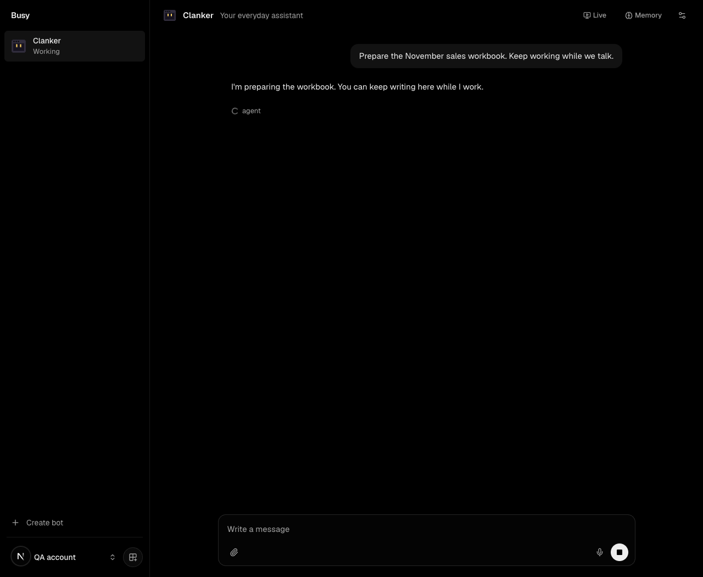
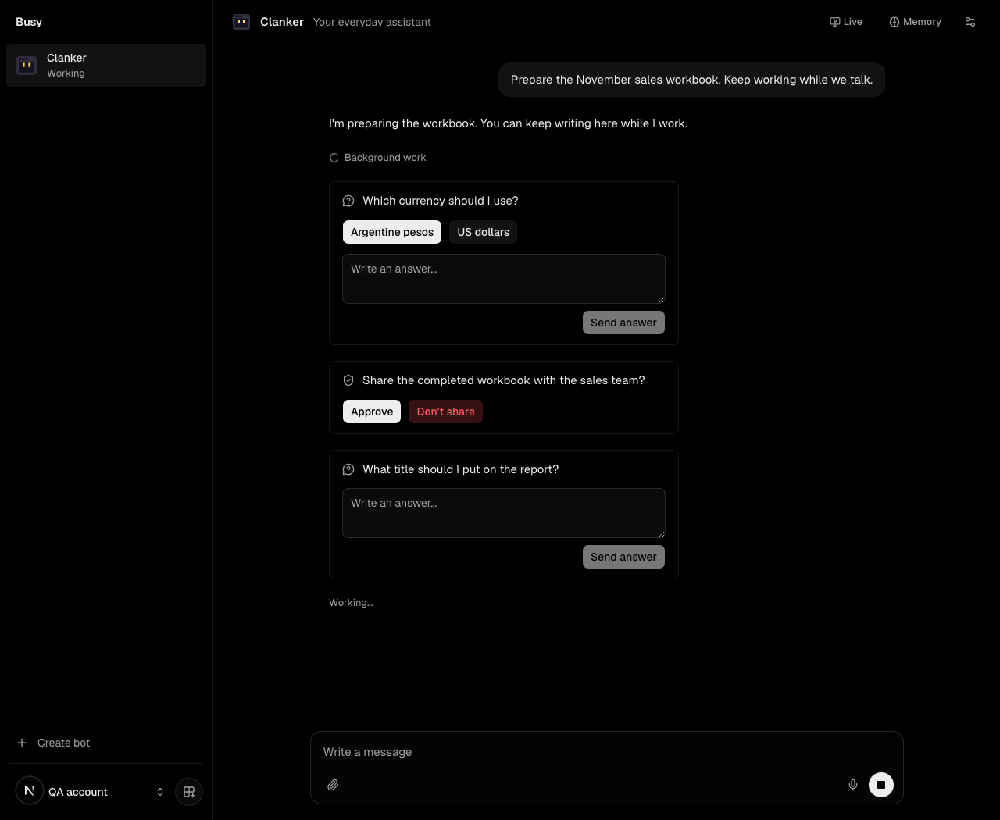
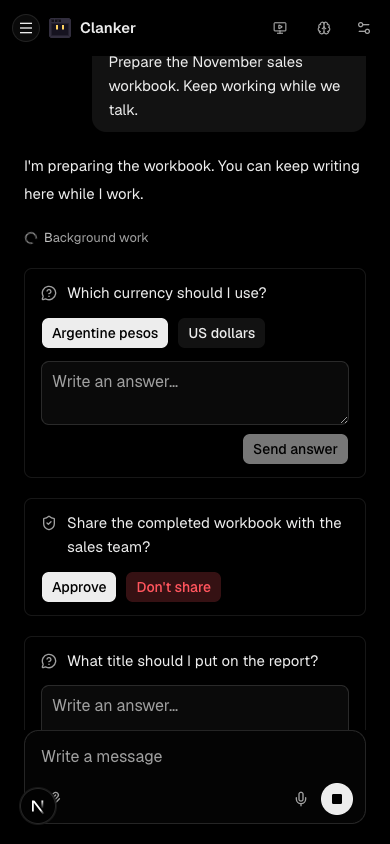

# Durable conversation visual checks

Captured on 2026-11-02 using the actual Next.js application and a temporary synthetic chat fixture. The fixture made no production requests and was removed afterward.

- Before and after captures use the same synthetic fixture and are included only
  to document the rendering change; no repository commit or deployment is
  required to interpret them.
- Same scenario and dark theme: a background agent is running, with native question, approval, and free-text interaction events.
- Desktop viewport: 1280×1050. Mobile viewport: 390×844.
- Checked separately through the browser: an unrelated message can be sent while the task remains running, a choice becomes settled, a denial is shown as declined, and the mobile page has no horizontal overflow.
- These screenshots validate rendering and interaction transport with synthetic events. They do not claim that a real model completed the workbook.

Before:

After:

